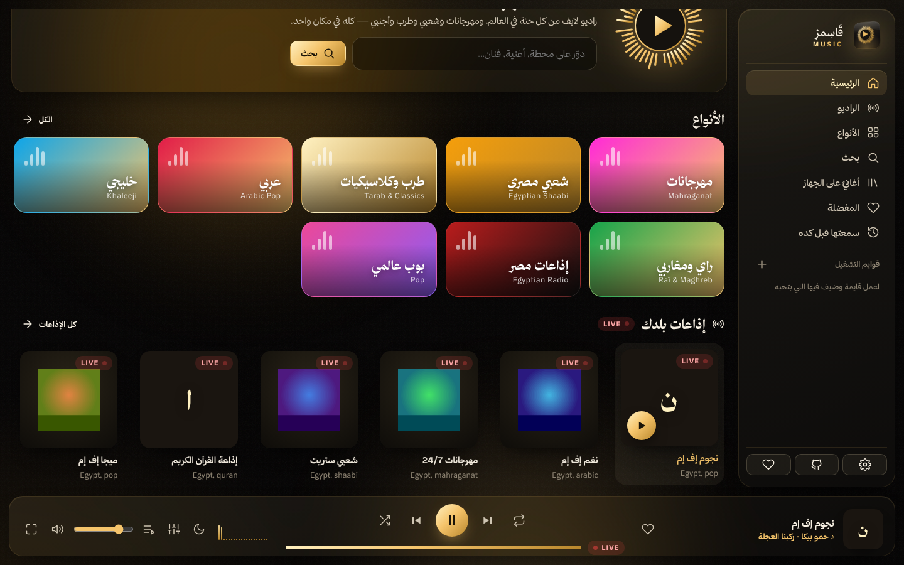
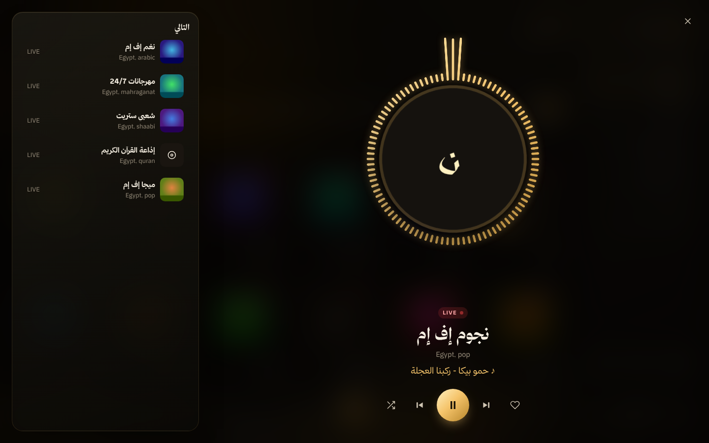
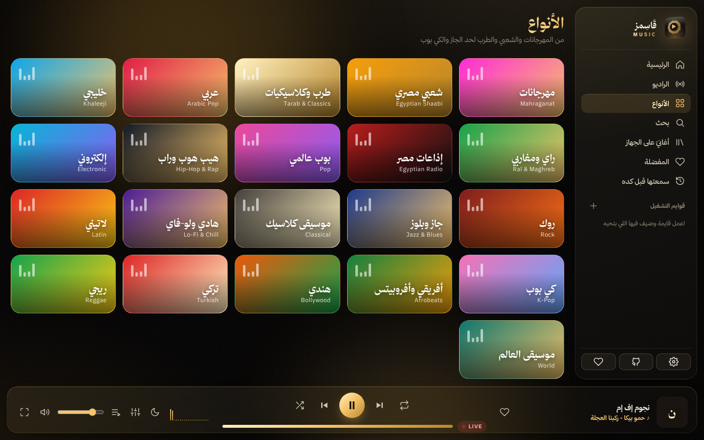
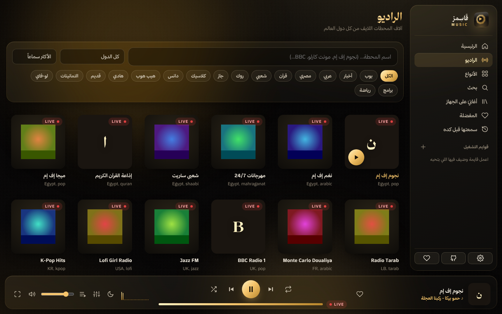
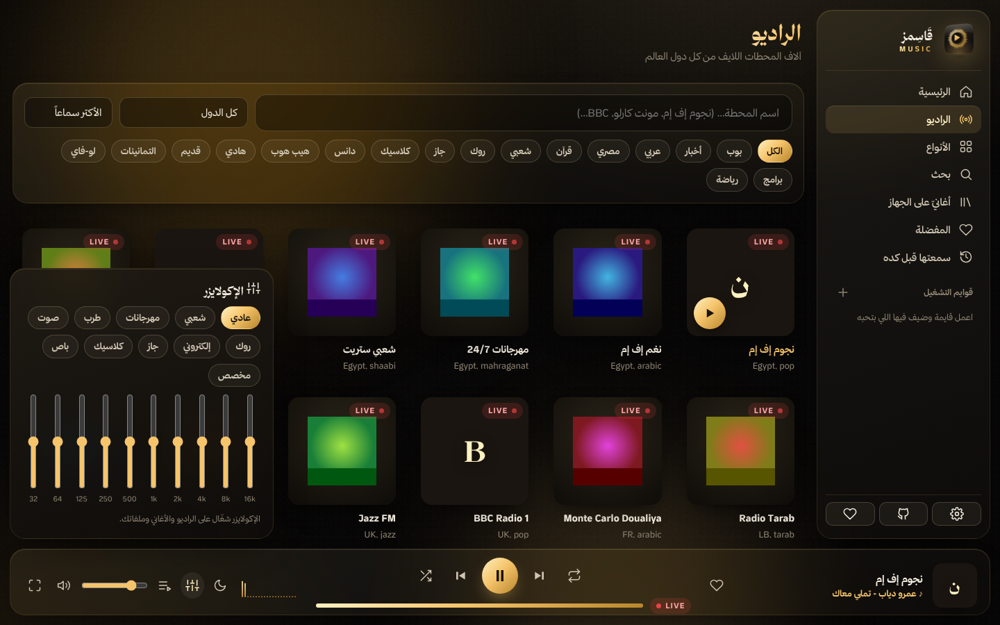
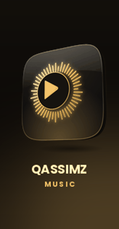

<div align="center">


# QASSIMZ Music

**استوديو استماع: راديو لايف من كل العالم، ومهرجانات وشعبي وطرب وعربي وأجنبي وموسيقى العالم، وأغانيك اللي على جهازك. كله في مكان واحد.**

من **أحمد قاسم — قَاسِمز** · مجاني ومفتوح المصدر · Windows 10/11

[⬇️ تحميل آخر إصدار](https://github.com/ahmedqassimtv-commits/qassimz-music/releases/latest) ·
[🐞 الدعم والإبلاغ عن مشكلة](https://github.com/ahmedqassimtv-commits/qassimz-music/issues) ·
[🌐 qassimz.com](https://qassimz.com)



</div>

---

## ✨ فيه إيه

| | |
|---|---|
| 📻 **راديو لايف** | آلاف المحطات من كل دول العالم (نجوم، نغم، مونت كارلو، BBC…)، وبتدوّر بالاسم أو الدولة أو النوع |
| 🎵 **اسم الأغنية الشغالة** | البرنامج بيقرا من المحطة اسم الأغنية اللي شغالة دلوقتي ويعرضه |
| 🎚️ **21 نوع** | مهرجانات · شعبي مصري · طرب وكلاسيكيات · عربي · خليجي · راي · إذاعات مصر · بوب · هيب هوب · إلكتروني · روك · جاز · كلاسيك · لو-فاي · لاتيني · كي بوب · أفريقي · هندي · تركي · ريجي · موسيقى العالم |
| 🎧 **أغاني** | من Audius (مجاني)، ومن يوتيوب (اختياري، بمشغّل يوتيوب الرسمي)، وتسجيلات نادرة لأم كلثوم وعبد الوهاب وغيرهم من Internet Archive |
| 💽 **أغانيك** | فولدرات الموسيقى اللي على جهازك، باسم الأغنية والفنان وصورة الألبوم |
| ✨ **شاشة التشغيل** | دايرة دهبي بتتحرك مع الإيقاع، زي اللوجو بالظبط |
| 🎛️ **إكولايزر 10 باند** | فيه إعدادات جاهزة: شعبي · مهرجانات · طرب · صوت · باص · روك… |
| ❤️ **مفضلة وقوايم تشغيل** | ومعاهم قايمة انتظار، وعشوائي، وتكرار، وسجل |
| 😴 **مؤقت نوم** | والصوت بيوطى تدريجياً قبل ما يقف |
| ⌨️ **أزرار الميديا** | أزرار الكيبورد وتحكم الصوت بتاع الويندوز شغالين |

<table><tr><td></td><td></td></tr>
<tr><td></td><td></td></tr></table>

## 🚀 التسطيب
1. نزّل `QASSIMZ-Music-Setup-x.x.x.exe` من [Releases](https://github.com/ahmedqassimtv-commits/qassimz-music/releases/latest).
2. لو ظهرت شاشة SmartScreen: **More info ← Run anyway**.
3. (اختياري) عشان تظهر الأغاني المشهورة من يوتيوب: ⚙ الإعدادات ← يوتيوب ← الصق مفتاح **YouTube Data API v3** (مجاني من Google Cloud).



شاشة التسطيب فيها اللوجو الدهبي بيلف 3D.

البرنامج بيتحدّث لوحده من GitHub، وبيانات المفضلة والقوايم على جهازك في `%APPDATA%\QASSIMZ Music`.
<br clear="left">

## ⚖️ المصادر والحقوق
البرنامج مش بيخزّن ولا بينزّل أغاني. بيشغّل بس من مصادر رسمية ومفتوحة:
[Radio Browser](https://www.radio-browser.info) (دليل محطات مفتوح)، [Audius](https://audius.co)، [Internet Archive](https://archive.org)، و[YouTube](https://youtube.com) بالمشغّل الرسمي.
كل الحقوق لأصحابها، وكل أغنية ليها زرار يوصّل لصفحة الفنان أو المصدر.

## 🛠️ للمطورين
```bash
pip install -r requirements.txt
python app/main.py              # البرنامج
python app/dev.py /tmp/data     # في المتصفح للتطوير
```
- `app/sources.py`: المصادر.
- `app/rooms.py`: الأنواع والإكولايزر.
- `app/server.py`: الـ API، وإعادة بث الصوت، وقراءة اسم الأغنية.
- `app/store.py`: المفضلة والقوايم والمكتبة.
- `app/ui/`: الواجهة.

**نشر إصدار جديد:** غيّر `VERSION` في `app/server.py` واعمل push على `main`.

---
<div align="center">© 2026 أحمد قاسم — قَاسِمز · MIT License</div>
